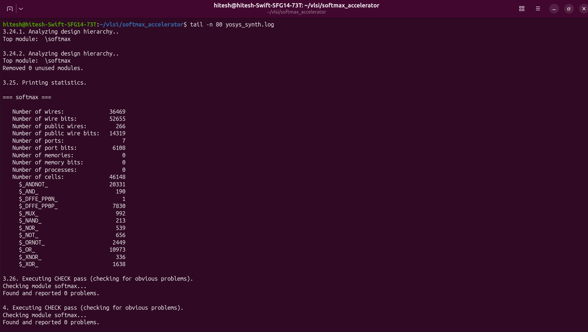
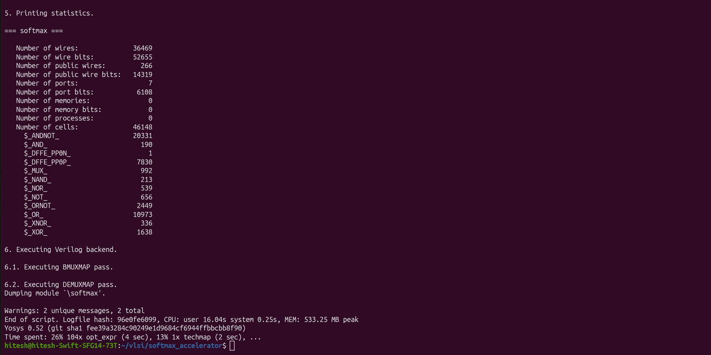

# Verilog Softmax Accelerator

A Verilog RTL implementation of an **N-input Softmax accelerator** using an FSM-based architecture, fixed-point arithmetic, and a lookup-table (LUT) approximation for the exponential function. The design is simulated with Icarus Verilog, inspected with GTKWave, and synthesized into generic logic using Yosys.

---

## 1. What Is the Softmax Function?

The Softmax function converts a group of real-valued scores, often called logits, into values that form a probability distribution. Each output is between 0 and 1, and the ideal mathematical outputs add up to 1.

For an input vector containing N values:

`x = [x0, x1, ..., x(N-1)]`

The Softmax output for element i is:

$$
\mathrm{Softmax}(x_i) = \frac{e^{x_i}}{\sum_{j=0}^{N-1} e^{x_j}}
$$

Here:
- `x_i` is the input logit at index i.
- `exp(x_i)` means e raised to the power of `x_i`.
- The denominator is the sum of the exponentials of all input logits.
- `N` is the number of input values.

A larger logit generally receives a larger Softmax output. Softmax preserves the ranking of the logits while converting the scores into normalized values.

### Where and why is Softmax used?

Softmax is commonly used in machine-learning classification systems, especially at the output layer of a neural network when a model chooses among classes. For example, a classifier might produce scores for cat, dog, and bird. Softmax converts those scores into normalized values that express each class's relative score.

Softmax is useful because it:
- converts unrestricted scores into non-negative normalized outputs;
- makes outputs easier to compare across classes;
- is differentiable, so it can be used during neural-network training with gradient-based optimization.

**Note:** Softmax outputs are not automatically calibrated probabilities of real-world correctness. Their interpretation depends on the model and how it was trained.

---

## 2. Numerically Stable Softmax

Directly calculating `exp(x_i)` can produce very large intermediate values when logits are large. A common numerically stable method subtracts the largest logit from every input.

Let `m = max(x_0, x_1, ..., x_(N-1))`.

Then calculate:

`Softmax(x_i) = exp(x_i - m) / sum(exp(x_j - m)), for j = 0 to N-1`

This is mathematically equivalent to the original formula because the same positive factor, `exp(-m)`, cancels from the numerator and denominator. The shifted exponent values are zero or negative, which reduces the risk of exponential overflow.

This project follows the max-subtraction approach and uses an exponential lookup-table (LUT) approximation instead of a full-precision exponential operator.

---

## 3. Example Using the Project's Test Inputs

The simulation was run with these four logits:

`x = [27, 21, 23, 19]`

### Step 1 - Find the maximum

`m = max(27, 21, 23, 19) = 27`

### Step 2 - Subtract the maximum from each logit

`x - m = [0, -6, -4, -8]`

### Step 3 - Calculate the exponential terms

For an ideal floating-point Softmax calculation, the terms are:

`[exp(0), exp(-6), exp(-4), exp(-8)]`

Approximately, these are:

`[1, 0.002479, 0.018316, 0.000335]`

Their sum is approximately:

`S = 1 + exp(-6) + exp(-4) + exp(-8) = 1.021130`

### Step 4 - Normalize the terms

The ideal mathematical outputs are approximately:

| Input logit | Shifted logit | Ideal Softmax output |
|---:|---:|---:|
| 27 | 0 | 0.97931 |
| 21 | -6 | 0.00243 |
| 23 | -4 | 0.01794 |
| 19 | -8 | 0.00033 |

The largest input, 27, receives the largest output. The ideal outputs add up to approximately 1.

### Step 5 - Compare with the RTL simulation

The testbench produced this output:

| Index | Input logit | RTL output |
|---:|---:|---:|
| 0 | 27 | 0.979324 |
| 1 | 21 | 0.002426 |
| 2 | 23 | 0.017929 |
| 3 | 19 | 0.000336 |

These are the values printed by the actual simulation. They are close to the ideal Softmax values, with small differences due to the lookup-table approximation and fixed-point arithmetic.

The RTL represents probability outputs using a scale of 65535. For this example, the testbench reports a sum of scaled probabilities of 65536. Small differences from the ideal sum can occur because of finite-precision arithmetic and integer rounding. The result should not be interpreted as exact floating-point normalization.

### Simulation output


---

## 4. RTL Architecture

The design uses a finite-state machine (FSM) to sequence the Softmax calculation. Its main stages are:

1. **IDLE** — waits for a computation request.
2. **FIND_MAX** — finds the maximum input logit.
3. **EXP_SUM** — calculates the approximated exponential terms and accumulates their sum.
4. **NORMALIZE** — calculates the scaled probability outputs.
5. **FINISH** — signals completion through `done`.

The exact timing and signal behavior can be inspected in the VCD waveform generated by the testbench.

### GTKWave waveform


The screenshot shows the top-level testbench signals over time. The `done` signal becomes asserted at the end of the computation. Packed buses such as `logits` and `probs` may be displayed as long hexadecimal or binary values; these buses represent multiple packed input and output elements.

---

## 5. Exponential LUT and Fixed-Point Representation

### Why is the scaling factor 256 used?

The RTL represents input logits in signed Q8.8 fixed-point format. In this format, the stored integer is scaled by **256**, which equals 2 to the power of 8. Eight fractional bits are reserved, so one real-valued unit corresponds to 256 stored counts.

- To encode a real-valued input: multiply it by 256 and round to an integer.
- To interpret a stored value as a real number: divide it by 256.

For example:
- Real value `1.5` is stored as `1.5 x 256 = 384`.
- Real value `-2.0` is stored as `-2.0 x 256 = -512`.

The factor 256 is a binary scaling convention. It does not change the intended Softmax result; it allows the hardware to represent fractional values using integers. The RTL must interpret the stored values consistently when calculating differences and using the exponential lookup table.

The design computes the difference between the maximum logit and each input in this Q8.8 representation. The exponential LUT uses steps of 1/16. Since one real unit corresponds to 256 stored counts, one LUT step corresponds to `256 / 16 = 16` raw counts. The interpolation logic uses the lower four bits of the difference to estimate values between LUT entries. Differences of 16.0 or greater correspond to a raw difference of `4096` (`16 x 256`) and are treated as zero contribution by the LUT approximation.

To avoid implementing a general-purpose exponential operator, the RTL uses a lookup table (LUT) for the shifted difference `d = m - x_i`.

- The LUT samples `exp(-d)` at intervals of `1/16` and uses linear interpolation between adjacent entries.
- The exponential values use a fixed-point scale of 32768 (Q1.15-style representation).
- Differences of 16.0 or greater are treated as zero contribution by the approximation.
- The probability output uses a scale of 65535, followed by integer rounding.

This is a hardware-oriented approximation: it reduces the need for a full exponential implementation, but it introduces quantization error. The cutoff also means that sufficiently small contributions are treated as zero. Therefore, the RTL outputs need not exactly match a floating-point software implementation.

---

## 6. Tools Used

- **Verilog** — RTL description of the accelerator.
- **Icarus Verilog** — compiles and runs the RTL testbench.
- **GTKWave** — visualizes the generated VCD waveform.
- **Yosys** — synthesizes the RTL into generic logic and reports statistics.

---

## 7. Run the Simulation

The commands below assume this repository structure:

```text
Verilog-Softmax-Accelerator/
├── README.md
├── rtl/
│   └── softmax.v
├── testbench/
│   └── softmax_tb.v
├── simulation/
│   └── screenshots/
└── synthesis/
    └── screenshots/
```

Run the commands from the repository root.

### Compile and run with Icarus Verilog

```bash
iverilog -g2012 -o softmax_sim rtl/softmax.v testbench/softmax_tb.v
vvp softmax_sim
```

Enter the number of inputs and the logits when prompted. The testbench writes `softmax.vcd` to the current working directory.

### View the waveform with GTKWave

```bash
gtkwave softmax.vcd
```

### Synthesize with Yosys

```bash
yosys -p "read_verilog -sv rtl/softmax.v; hierarchy -top softmax; synth -top softmax; check; stat; write_verilog -noattr softmax_synth.v" 2>&1 | tee yosys_synth.log
```

This command:
1. reads the RTL;
2. checks the top-level module hierarchy;
3. synthesizes the design into generic logic;
4. runs a structural check;
5. prints synthesis statistics;
6. writes a synthesized Verilog netlist to `softmax_synth.v`;
7. saves the command output in `yosys_synth.log`.

To inspect the final log output:

```bash
tail -n 80 yosys_synth.log
```

To locate successful structural-check messages:

```bash
grep -n "Found and reported 0 problems" yosys_synth.log
```

---

## 8. Synthesis Results

The recorded Yosys generic synthesis report includes:

| Metric | Reported value |
|---|---:|
| Wires | 36,469 |
| Wire bits | 52,655 |
| Public wires | 266 |
| Public wire bits | 14,319 |
| Ports | 7 |
| Port bits | 6,108 |
| Generic logic cells | 46,148 |
| Memories | 0 |
| Processes | 0 |

Yosys reported **“Found and reported 0 problems.”** in the structural check.

### Yosys check and statistics



### Final synthesis report



**Interpretation:** These are generic synthesis statistics, not a physical area, timing, or power result. The cell counts are not Sky130 standard-cell counts because a Sky130 technology-mapping flow has not yet been performed.

---

## Author

**Hitesh T P**
