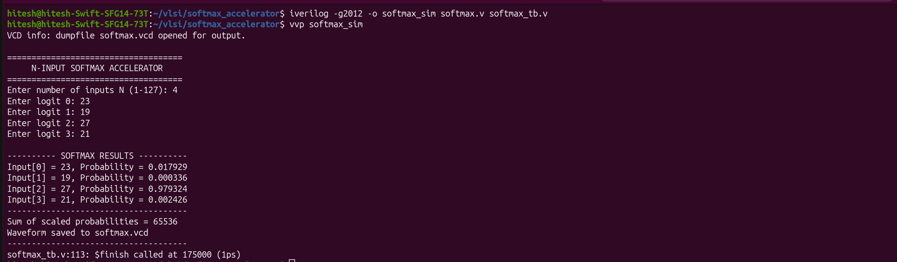
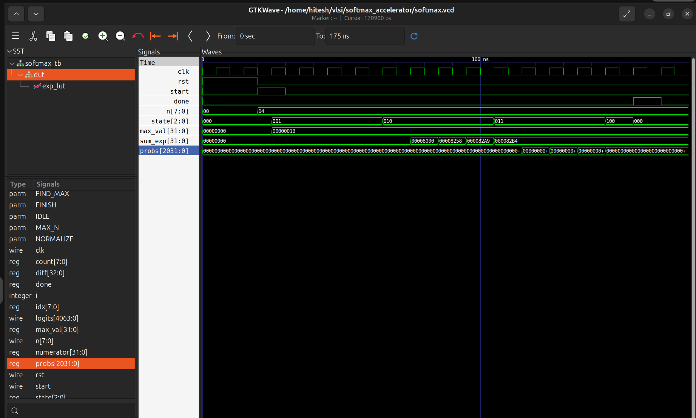

# Verilog Softmax Accelerator

A Verilog RTL implementation of an **N-input Softmax accelerator** using an FSM-based architecture, fixed-point arithmetic, and a lookup-table (LUT) approximation for the exponential function. The design is simulated with Icarus Verilog, inspected with GTKWave, and synthesized into generic logic using Yosys.

---

## 1. What Is the Softmax Function?

The **Softmax function** converts a group of real-valued scores, often called *logits*, into a group of values that can be interpreted as a probability distribution. Each output is between 0 and 1, and the ideal mathematical outputs sum to 1.

For an input vector

\[
\mathbf{x} = [x_0, x_1, \ldots, x_{N-1}],
\]

the Softmax output for element \(i\) is

\[
\boxed{\operatorname{softmax}(x_i) =
\frac{e^{x_i}}{\sum_{j=0}^{N-1} e^{x_j}}}
\]

where:
- \(x_i\) is the \(i\)-th input logit,
- \(e^{x_i}\) is the exponential of that logit,
- the denominator sums the exponentials of all logits,
- \(N\) is the number of input values.

A larger logit generally receives a larger Softmax probability. Softmax preserves the ranking of the logits while turning the scores into normalized outputs.

### Where and why is Softmax used?

Softmax is commonly used in machine-learning classification systems, especially at the output layer of a neural network when a model is expected to choose among mutually exclusive classes. For example, a classifier might produce scores for *cat*, *dog*, and *bird*. Softmax converts those scores into normalized values that help express the model's relative confidence across those classes.

Softmax is useful because it:
- converts unrestricted scores into non-negative normalized outputs;
- makes the outputs easier to compare as a distribution across classes;
- is differentiable, making it suitable for neural-network training with gradient-based optimization.

**Important:** Softmax outputs are not automatically calibrated probabilities of real-world correctness. Their interpretation depends on the model, training objective, and calibration.

---

## 2. Numerically Stable Softmax

Directly calculating \(e^{x_i}\) can cause very large intermediate values when logits are large. A common numerically stable form subtracts the maximum logit from every input.

Let

\[
m = \max_j(x_j).
\]

Then

\[
\boxed{\operatorname{softmax}(x_i) =
\frac{e^{x_i-m}}{\sum_{j=0}^{N-1}e^{x_j-m}}}
\]

This is mathematically equivalent to the original formula because the same positive factor \(e^{-m}\) cancels from the numerator and denominator. The shifted exponent arguments are non-positive, reducing the risk of exponential overflow.

This design follows a max-subtraction approach and uses an exponential lookup-table approximation rather than a full-precision exponential operator.

---

## 3. Example Using the Project's Test Inputs

The simulation was run with the following four logits:

\[
\mathbf{x} = [27,\;21,\;23,\;19].
\]

### Step 1 — Find the maximum

\[
m = \max(27,21,23,19) = 27.
\]

### Step 2 — Subtract the maximum from each logit

\[
\mathbf{x}-m = [0,\;-6,\;-4,\;-8].
\]

### Step 3 — Calculate the exponential terms

For an ideal floating-point Softmax calculation, the terms would be

\[
[e^0,\;e^{-6},\;e^{-4},\;e^{-8}]
\]

which are approximately

\[
[1,\;0.002479,\;0.018316,\;0.000335].
\]

Their sum is approximately

\[
S = 1 + e^{-6} + e^{-4} + e^{-8} \approx 1.021130.
\]

### Step 4 — Normalize the terms

The ideal mathematical outputs are approximately:

| Input logit | Shifted logit | Ideal Softmax output (approx.) |
|---:|---:|---:|
| 27 | 0 | 0.97931 |
| 21 | -6 | 0.00243 |
| 23 | -4 | 0.01794 |
| 19 | -8 | 0.00033 |

The largest input, **27**, receives the largest output. The outputs are normalized so their ideal sum is 1.

### Step 5 — Compare with this RTL simulation

The testbench produced the following output:

| Index | Input logit | RTL output |
|---:|---:|---:|
| 0 | 27 | 0.979324 |
| 1 | 21 | 0.002426 |
| 2 | 23 | 0.017929 |
| 3 | 19 | 0.000336 |

These are the values printed by the actual simulation. They are close to the ideal Softmax values, with small differences due to the design's lookup-table approximation and fixed-point arithmetic.

The RTL uses a fixed-point representation scaled to **65535** for probability outputs. The testbench reports a sum of scaled probabilities of **65536** for this example. Small differences from the ideal sum can occur because of finite-precision arithmetic and integer rounding; this should not be interpreted as exact floating-point normalization.

### Simulation output



---

## 4. RTL Architecture

The design uses a finite-state machine (FSM) to sequence the Softmax calculation. Its main stages are:

1. **IDLE** — waits for a computation request.
2. **FIND_MAX** — finds the maximum input logit.
3. **EXP_SUM** — calculates the approximated exponential terms and accumulates their sum.
4. **NORMALIZE** — calculates the scaled probability outputs.
5. **FINISH** — signals completion through `done`.

The exact timing and signal behavior can be inspected in the VCD waveform generated by the testbench.

### GTKWave waveform



The screenshot shows the top-level testbench signals over time. The `done` signal becomes asserted at the end of the computation. Packed buses such as `logits` and `probs` may be displayed as long hexadecimal or binary values; these buses represent multiple packed input and output elements.

---

## 5. Exponential LUT and Fixed-Point Representation

### Why is the scaling factor 256 used?

The RTL represents input logits in **signed Q8.8 fixed-point format**. In this format, the stored 16-bit integer is scaled by **256 (2^8)**: eight fractional bits are reserved, so one real-valued unit corresponds to 256 stored counts. To convert a stored raw value back to its real value, divide it by 256; to encode a real value, multiply it by 256 and round to an integer.

\[\text{raw input} = \text{real-valued logit} \times 256,\qquad \text{real-valued logit} = \frac{\text{raw input}}{256}.\]

For example, the real logit \(1.5\) is stored as \(1.5 \times 256 = 384\), while \(-2.0\) is stored as \(-2.0 \times 256 = -512\). The factor 256 is a binary scaling convention, not a multiplier that changes the intended Softmax result: it lets the hardware represent fractional values using integers. The RTL must interpret the stored values consistently when computing differences and looking up exponential values.

The design computes the difference between the maximum logit and each input in this same Q8.8 representation. The exponential LUT uses steps of \(1/16\); because Q8.8 has 256 counts per unit, one LUT step corresponds to \(256/16 = 16\) raw counts. The interpolation logic uses the lower four bits of the difference to estimate values between LUT entries. Differences of 16.0 or greater (raw difference \(4096 = 16 \times 256\)) are treated as zero contribution by the LUT approximation.

To avoid implementing a general-purpose exponential operator, the RTL uses a lookup table (LUT) for the shifted difference \(d = m - x_i\).

- The LUT samples \(e^{-d}\) at intervals of \(1/16\) and uses linear interpolation between adjacent entries.
- The exponential values use a fixed-point scale of 32768 (Q1.15-style representation).
- Differences of 16.0 or greater are treated as zero contribution by the approximation.
- The probability output uses a scale of 65535, followed by integer rounding.

This is a hardware-oriented approximation: it reduces the need for a full exponential implementation, but it introduces quantization error. The cutoff also means that sufficiently small contributions are treated as zero. Therefore, the RTL outputs need not exactly match a floating-point software implementation.

---

## 6. Tools Used

- **Verilog** — RTL description of the accelerator.
- **Icarus Verilog** — compiles and runs the RTL testbench.
- **GTKWave** — visualizes the generated VCD waveform.
- **Yosys** — synthesizes the RTL into generic logic and reports statistics.

---

## 7. Run the Simulation

The commands below assume this repository structure:

```text
Verilog-Softmax-Accelerator/
├── README.md
├── rtl/
│   └── softmax.v
├── testbench/
│   └── softmax_tb.v
├── simulation/
│   └── screenshots/
└── synthesis/
    └── screenshots/
```

Run the commands from the repository root.

### Compile and run with Icarus Verilog

```bash
iverilog -g2012 -o softmax_sim rtl/softmax.v testbench/softmax_tb.v
vvp softmax_sim
```

Enter the number of inputs and the logits when prompted. The testbench writes `softmax.vcd` to the current working directory.

### View the waveform with GTKWave

```bash
gtkwave softmax.vcd
```

### Synthesize with Yosys

```bash
yosys -p "read_verilog -sv rtl/softmax.v; hierarchy -top softmax; synth -top softmax; check; stat; write_verilog -noattr softmax_synth.v" 2>&1 | tee yosys_synth.log
```

This command:
1. reads the RTL;
2. checks the top-level module hierarchy;
3. synthesizes the design into generic logic;
4. runs a structural check;
5. prints synthesis statistics;
6. writes a synthesized Verilog netlist to `softmax_synth.v`;
7. saves the command output in `yosys_synth.log`.

To inspect the final log output:

```bash
tail -n 80 yosys_synth.log
```

To locate successful structural-check messages:

```bash
grep -n "Found and reported 0 problems" yosys_synth.log
```

---

## 8. Synthesis Results

The recorded Yosys generic synthesis report includes:

| Metric | Reported value |
|---|---:|
| Wires | 36,469 |
| Wire bits | 52,655 |
| Public wires | 266 |
| Public wire bits | 14,319 |
| Ports | 7 |
| Port bits | 6,108 |
| Generic logic cells | 46,148 |
| Memories | 0 |
| Processes | 0 |

Yosys reported **“Found and reported 0 problems.”** in the structural check.

### Yosys check and statistics


### Final synthesis report


**Interpretation:** These are generic synthesis statistics, not a physical area, timing, or power result. The cell counts are not Sky130 standard-cell counts because a Sky130 technology-mapping flow has not yet been performed.

---

## Author

**Hitesh T P**
